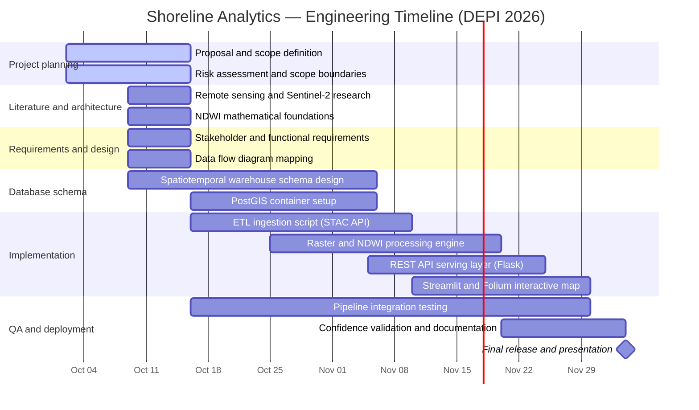

# Shoreline Analytics

A colorful project overview for **Shoreline Analytics: Satellite-Based Coastal Erosion & Risk Mapping in Alexandria**. The page summarizes the supplied literature review, project plan, and requirements gathering document.

## View the colorful page

After adding `index.html` to this repository, open **Settings → Pages**. Under **Build and deployment**, select **Deploy from a branch**, choose `main` and `/(root)`, then save. GitHub will show a Pages link here after deployment finishes.

## Project Gantt chart

This is Mermaid Gantt syntax. Keep the opening and closing `mermaid` fences; GitHub renders the chart in Markdown preview and on the README page.

## Add or edit the Gantt code in GitHub

1. Open the repository and choose **Add file → Create new file**.
2. Name it `README.md` (or `PROJECT_PLAN.md` if a README already exists).
3. Paste the chart above. GitHub renders it when it is inside a fenced block that starts with `mermaid`.
4. Scroll down, enter a commit message, and select **Commit changes**.

To update the schedule later, edit a task's label, start date, or duration in its line. Dates use `YYYY-MM-DD`.
