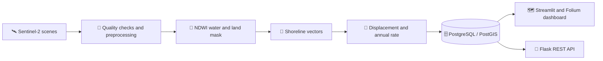
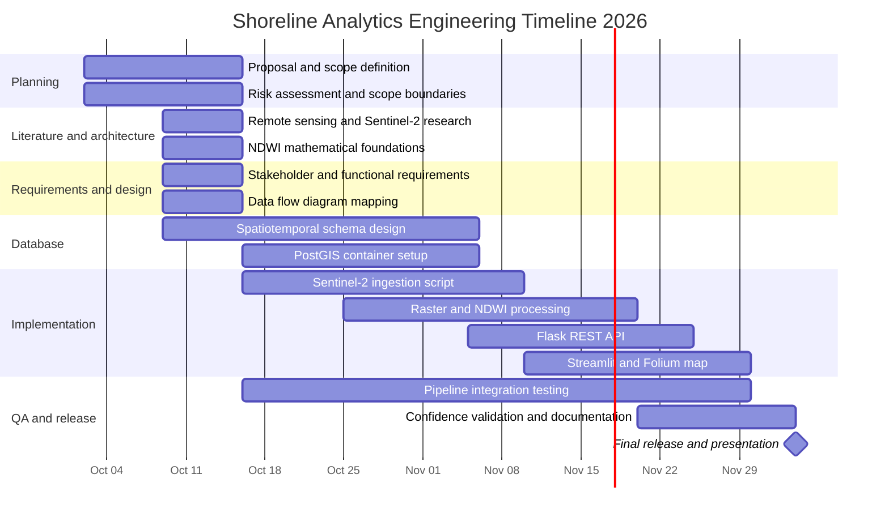

# 🌊 Shoreline Analytics

### Satellite Based Coastal Erosion and Risk Mapping in Alexandria

*Turning satellite observations into clear, inspectable evidence about shoreline change.*

---

## 🗺️ Project at a glance

| 📍 Study area | 🛰️ Imagery | 📆 Observation period | 🏖️ Coastal sectors |
|:--|:--|:--|:--|
| Alexandria, Egypt | Sentinel-2 | 2018–2026 | Corniche Infill · Eastern Harbour · Montaza Bay |

Shoreline Analytics is a geospatial data engineering project that will extract shorelines from suitable Sentinel-2 scenes, measure shoreline movement, estimate annualized erosion rates, and present the results through a map dashboard and REST API.

> **Observation note:** The current plan selects one suitable, low-cloud image for each year. Results represent the shoreline on those image dates; they do not capture every seasonal fluctuation or short-term coastal event.

## 🔄 How the platform works

## 🧪 Analysis method

The project uses the Normalized Difference Water Index (NDWI) to help separate water from land in Sentinel-2 imagery:

$$
\mathrm{NDWI} = \frac{\mathrm{Green} - \mathrm{NIR}}{\mathrm{Green} + \mathrm{NIR}}
$$

For Sentinel-2, the planned inputs are **Band 3 (Green)** and **Band 8 (Near Infrared)**. The resulting water/land mask is used to extract shoreline vectors for each selected observation. Shoreline positions are then compared to estimate displacement and annualized rates, with confidence information stored alongside the results.

## ✨ Planned project features

- 🛰️ Find and filter Sentinel-2 scenes for the Alexandria study area.
- 🧮 Calculate NDWI and extract shoreline vectors for the selected sectors and years.
- 🗄️ Store shoreline geometry, dates, sector identifiers, metrics, risk labels, and confidence scores in PostgreSQL/PostGIS.
- 📊 Explore observations with a year selector, map layers, risk markers, KPI cards, and sector information popups.
- 🔌 Request risk, erosion-rate, and confidence information through a Flask API.
- 📤 Export supported spatial layers as GeoJSON.

### Technology palette

## 📅 Project Gantt chart

## 👥 Team and work areas

| Team member | Work area |
|:--|:--|
| **Asmaa Bahaa** | Sentinel-2 ingestion, cloud filtering, shoreline change, and annual erosion rates |
| **Doha Yehia** | NDWI, water/land masks, and shoreline extraction |
| **Hagar Arafa** | PostgreSQL/PostGIS schema, data loading, risk and confidence queries |
| **Nourhan Fathy** | Streamlit/Folium dashboard, map layers, KPIs, and GeoJSON export |
| **Shahd Abdelnasser** | Flask API, Docker Compose, and automated tests |

## 🧭 Scope for the first version

**Included:** three Alexandria sectors; Sentinel-2 scenes from 2018 to 2026 where suitable imagery is available; Python geospatial processing; PostgreSQL/PostGIS; a local Docker-based setup; a dashboard and API.

**Future work:** whole-coast coverage, additional satellite sources, seasonal observations, automatic scheduling, expanded API features, and cloud deployment.

## 📄 Project documents

- [Literature Review](literature-review.md)
- [Project Planning and Management](project-planning-and-management.md)
- [Requirements Gathering](requirements-gathering.md)
## 📚 Selected references

- McFeeters, S. K. (1996). The use of the Normalized Difference Water Index (NDWI) in the delineation of open water features. *International Journal of Remote Sensing, 17*(7), 1425–1432. [https://doi.org/10.1080/01431169608948714](https://doi.org/10.1080/01431169608948714)
- Abou Samra, R. M., & Ali, R. R. (2021). Applying DSAS tool to detect coastal changes along Nile Delta, Egypt. *The Egyptian Journal of Remote Sensing and Space Science, 24*(3), 463–470. [https://doi.org/10.1016/j.ejrs.2020.11.002](https://doi.org/10.1016/j.ejrs.2020.11.002)
- Pucino, N., et al. (2022). Assessing the accuracy of Sentinel-2 instantaneous subpixel shorelines using synchronous UAV ground truth surveys. *Remote Sensing of Environment, 282*, 113293. [https://doi.org/10.1016/j.rse.2022.113293](https://doi.org/10.1016/j.rse.2022.113293)
- Vos, K., et al. (2023). Benchmarking satellite-derived shoreline mapping algorithms. *Communications Earth & Environment, 4*, 345. [https://doi.org/10.1038/s43247-023-01001-2](https://doi.org/10.1038/s43247-023-01001-2)
- Pardo-Pascual, J. E., et al. (2024). Assessment of satellite-derived shorelines automatically extracted from Sentinel-2 imagery using SAET. *Coastal Engineering, 188*, 104426. [https://doi.org/10.1016/j.coastaleng.2023.104426](https://doi.org/10.1016/j.coastaleng.2023.104426)
- El-Masry, E. A., et al. (2024). Multi-decadal coastal change detection using remote sensing: The Mediterranean coast of Egypt between El-Dabaa and Ras El-Hekma. *Environmental Monitoring and Assessment, 196*, 182. [Article](https://link.springer.com/article/10.1007/s10661-024-12359-x)

---

**Shoreline Analytics** · ALX5_AIS5_G1 · Alexandria, Egypt

